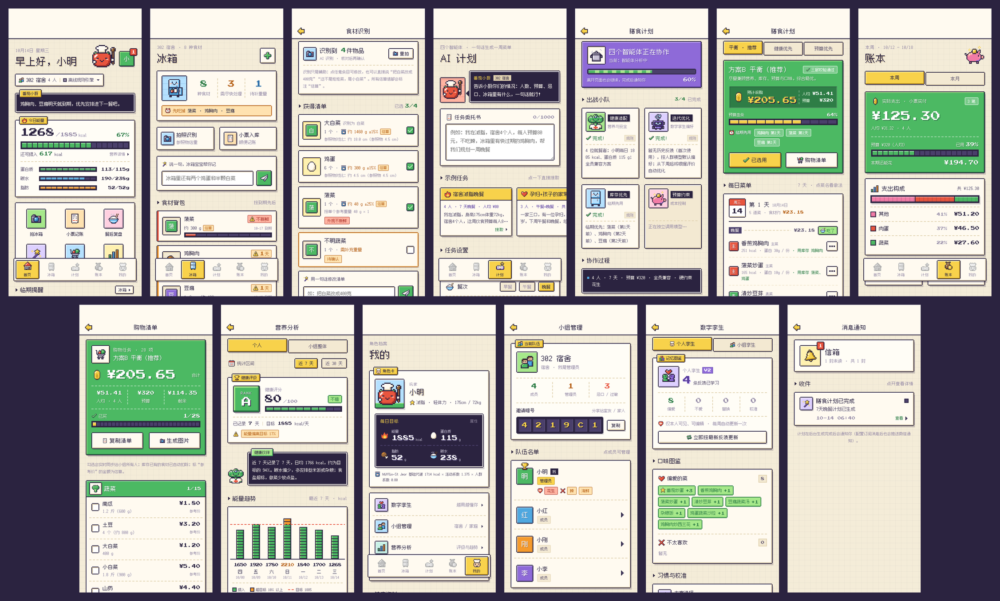

# MealAgent · AI 膳食统筹微信小程序

[English](README.md) | 中文 · 📋 [项目进展与待办](docs/PROJECT_STATUS.md)

依据设计文档 [`MealAgent_Project_Design_Document_Final_EN.md`](MealAgent_Project_Design_Document_Final_EN.md)（V3.1 终版）实现的 AI 膳食统筹微信小程序。
它把六个环节串成闭环：**库存 → 预算 → 健康 → 多智能体周计划 → 购物 → 餐后复盘**；
**膳食数字孪生**会从每一次修改、评分和纠正中学习，越用越懂你。



```
miniprogram/   微信小程序（12 个页面，原生 WXML/WXSS/JS）
backend/       FastAPI 后端：业务服务、DeepSeek 客户端、多智能体调度器
llm_wiki/      所有智能体共享的结构化 Markdown 知识库（食材、人群模型、规则、菜谱）
```

## 功能对照（设计文档 → 代码）

| 文档章节 | 功能说明 | 代码位置 |
|---|---|---|
| 4.1 库存：拍照 / 小票 / 对话录入 | 照片交给 DeepSeek 多模态识别，返回可编辑的**清单卡片**；可以点条目修改，也可以直接说“把白菜改成400克” | `routers/recognition.py`、`services/recognition.py`、`services/chat.py`、`pages/recognize` |
| 4.1.2 参照物比例估算 | 用照片中参照物（默认鸡蛋）的尺寸比例估算重量，结果带 ±15% / ±25% 区间并标注“估算”；用户的纠正会通过数字孪生校准之后的估算 | `services/estimation.py`、`llm_wiki/03_rules/portions.md` |
| 4.1.3 双维度新鲜度预警 | 按食材类别设置保质期阈值；日期优先取小票购买日，没有则取录入日；外观“不新鲜”优先于时间判断 | `services/inventory.py`、`03_rules/shelf_life.md` |
| 4.1.4 库存扣减 | 自动：餐后拍照复盘，在家做饭时扣减库存（外食不动库存）；手动：说“今天用了两个鸡蛋”，或在计划里点“吃了 ✓” | `routers/recognition.py`、`routers/plans.py` |
| 4.2 预算与记账 | 记账记录**小票实付金额**；成本测算**优先用历史成交价**，没有时用参考价并标注“估算”；缺失单价按分级规则补全；默认人均预算，可切换总预算；周报 / 月报 | `services/pricing.py`、`routers/expenses.py`、`pages/budget` |
| 4.3 人群模型、硬 / 软约束 | 10 个人群膳食模型；过敏原是硬约束，一票否决，连调料也算（如蚝油算海鲜）；口味忌口是软约束，用户可推翻；差异化多菜按需触发，并标注“适合谁” | `agents/context.py`、`llm_wiki/02_dietary_group_models/` |
| 4.4 健康指标 | 按《中国居民膳食营养素参考摄入量（2023版）》，用 Mifflin-St Jeor 公式结合人群模型计算能量与三大营养素目标；所有输出附带医疗免责声明 | `services/nutrition.py` |
| 4.6 多人协作 | 家庭 / 宿舍小组，邀请码加入，管理员 / 成员两级权限，共享预算；WebSocket 实时同步库存、购物勾选和计划 | `routers/groups.py`、`realtime.py`、`app.js` |
| 4.7 营养分析 | 每日 / 每周能量、三大营养素、维生素矿物质估算、膳食健康评分；支持个人和小组视图，并注明数据来源 | `routers/users.py`、`pages/nutrition` |
| 4.8 智能购物清单 | 计划所需减去库存，按超市分区排序，显示总价与人均，高亮超预算；可复制文字或保存为图片 | `services/shopping.py`、`pages/shopping` |
| 4.9 餐后拍照复盘 | 区分在家做饭与外食；记录与计划的偏差并写入数字孪生 | `services/recognition.py` |
| 4.10 数字孪生 | 个人孪生仅本人可见、可编辑；群体孪生可见范围可设为仅创建者 / 指定成员 / 全部成员；由反馈事件构建，每周或手动更新 | `services/twin.py`、`pages/twin` |
| 5 多智能体调度 | 中央调度器 + **四个各自独立调用 LLM 的智能体**；三层校验器把不通过的问题退回负责的智能体重做（最多 3 次）；A/B/C 三套方案按数字孪生排序；SSE 流式输出，离开页面后后台继续生成并在完成时通知；结果缓存 | `agents/`、`jobs.py` |

## 一份计划是怎么生成的

```
用户指令 ──► 调度器：解析意图（LLM，规则解析兜底）+ 从数据库组装上下文
              │  就餐者与营养目标 · 硬/软约束 · 库存（+ 指令中提到的食材）
              │  价格记忆 · 个人+群体孪生 · 候选菜池（已执行硬约束否决）
              ▼
   ┌──────────── 并行、彼此独立的 LLM 调用（各自的系统提示词 + 各自的上下文）────────────┐
   │ 健康适配（优先级1）│ 迭代优化（优先级2）│ 库存优先（优先级3）│ 预算约束（优先级4）│
   └──────────────────────────────────────────────────────────────────────────────────────┘
              ▼  推送：总体框架
   调度器编排方案B（LLM 调用）─► 计算每人份量、营养、成本、“适合谁”标签
              ▼
   校验器：硬约束否决 → 库存 → 营养 → 预算
     └─ 不通过 ► 问题退回负责的智能体 revise() → 应用修改 → 重新校验（≤3 次）
              ▼  有冲突？（预算紧、临期食材用不完、发生过回退、就餐者需求不同）
   并行生成方案A（健康优先）与方案C（预算优先）─► 按数字孪生排序
              ▼  推送：各方案 → 逐日菜单 → 购物清单 → 完成（+ 站内通知 / 微信订阅消息）
```

确定性的事实（能量目标、保质期、价格、过敏原匹配、校验）由代码依据知识库计算；
LLM 智能体在此基础上做判断：选哪些菜、怎么排期、怎么替换。智能体不直接访问数据库。
每次智能体调用都会记录，并在 `result.llm_usage` 中返回。

## 快速开始

### 1. 后端（Python ≥ 3.10）

```bash
cd backend
python -m venv .venv && source .venv/bin/activate
pip install -r requirements.txt
cp .env.example .env          # 然后填写 DEEPSEEK_API_KEY（见下文）
uvicorn app.main:app --host 0.0.0.0 --port 8000
# 接口文档：http://127.0.0.1:8000/docs
```

`.env` 中的 DeepSeek 配置：

- `DEEPSEEK_API_KEY`、`DEEPSEEK_BASE_URL`（默认 `https://api.deepseek.com`）、`DEEPSEEK_MODEL`（默认 `deepseek-chat`）：
  供调度器和四个智能体使用。
- `DEEPSEEK_VISION_MODEL`（以及可选的 `DEEPSEEK_VISION_BASE_URL` / `DEEPSEEK_VISION_API_KEY`）：用于拍照识别。
  需要指向一个**支持图片输入的 DeepSeek 部署**（接受 OpenAI 格式的 `image_url` 内容）。
  如果你的接口只支持文本，拍照识别会失败并自动退回到手动 / 对话录入。

**离线模式。** 不配置 API Key（或设置 `MEALAGENT_OFFLINE=1`）时，后端仍可完整运行，使用规则引擎：
每个智能体的确定性分析 + 基于打分的编排器。离线模式用于开发和测试；此时拍照识别会返回空卡片，由你通过对话补充。
正式演示请使用 DeepSeek；界面会标明每份计划是由哪种模式生成的（“LLM”或“规则”）。

对运行中的服务端完整跑一遍设计文档第 7 节的演示脚本：

```bash
python scripts/demo.py --base http://127.0.0.1:8000
```

### 2. 小程序

1. 打开**微信开发者工具** → 导入项目 → 选择 `miniprogram/` 目录。
2. 把 `miniprogram/project.config.json` 中的 `appid` 换成你自己的（或使用测试号）。
3. 修改 `miniprogram/config.js`：在模拟器中 `baseUrl` / `wsUrl` 保持 `127.0.0.1:8000`；
   真机调试时改为电脑的局域网 IP，并在开发者工具中勾选“不校验合法域名”。
4. 登录：后端配置了 `WECHAT_APPID` / `WECHAT_SECRET` 时调用 `code2session`；否则使用每台设备固定的开发 ID，
   所以本地开发不需要任何微信凭证。
5. 可选：设置 `planTemplateId`（以及后端的 `WECHAT_PLAN_TEMPLATE_ID`），计划在后台生成完成时会收到微信订阅消息。

页面：首页 · 冰箱 · 计划 · 账本 · 我的（底部标签栏），以及计划详情（流式展示）、识别卡片、购物清单、
营养分析、小组管理、数字孪生和消息通知。

正式上线需在小程序后台配置 HTTPS / WSS 合法域名。

### 3. 测试

```bash
cd backend
pip install -r requirements-dev.txt
pytest
```

28 个测试覆盖：知识库解析；中英文指令解析（含演示指令）；营养目标；单价分级补全；参照物估算与校准；
新鲜度；购物清单；演示脚本全流程（不含辣和海鲜、临期鸡胸肉在第 2 天前用掉、不超预算、三套方案均通过校验）；
连调料在内的硬约束；孕妇成员的差异化多菜；预算智能体回退；数字孪生偏好影响排序；
用模拟 LLM **验证每个智能体都用自己的提示词独立调用模型**；以及完整的 API 流程（登录 → 小组 → 权限 →
对话改库存 → 计划任务 + SSE 回放 → 选用 / 修改 / 评分 → 购物勾选 → 标记已吃 → 数字孪生学习与可见范围 →
小票记账 → 拍照识别、估重与纠正 → 在家 / 外食复盘 → WebSocket 同步）。

## 知识库（LLM Wiki）

纯 Markdown，人可以直接编辑，后端也直接解析。格式约定见 `llm_wiki/00_index.md`：

- `01_ingredients/*.md`：每种食材一行：每 100 g 营养、参考价格区间（元/kg）、保质期类别、单个重量与尺寸、
  过敏原和标签。新增一行，该食材立刻可用于规划、成本测算和估重。可通过新增列或新增文件接入 USDA 等其他来源。
- `02_dietary_group_models/*.md`：`## Parameters`（机器可读参数）+ 注入智能体提示词的指导原则。
- `03_rules/*.md`：保质期、参照物、冲突优先级、预算口径、营养阈值。
- `04_dish_templates/*.md`：菜谱模板（每人份用量）。智能体也可以用已知食材提出新菜，未知食材会被校验器拒绝。

营养数值为参照《中国食物成分表》（第6版）整理的近似值；营养目标依据《中国居民膳食营养素参考摄入量（2023版）》
和《中国居民膳食指南（2022）》。答辩前请核对数值，并按所在城市校准参考价格。

## 接口概览

| 模块 | 接口 |
|---|---|
| 登录 / 个人资料 | `POST /api/auth/login`、`GET/PUT /api/me`、`GET /api/me/targets`、`GET /api/me/nutrition`、`GET /api/me/meals` |
| 数字孪生 | `GET/PUT /api/me/twin`、`POST /api/me/twin/refresh`、`GET /api/groups/{id}/twin` |
| 小组 | `GET/POST /api/groups`、`POST /api/groups/join`、`GET/PUT /api/groups/{id}`、`PUT/DELETE /api/groups/{id}/members/{uid}`、`GET /api/groups/{id}/nutrition` |
| 库存 | `GET/POST /api/groups/{id}/inventory`、`POST /api/groups/{id}/inventory/chat`、`POST /api/groups/{id}/inventory/consume`、`PUT/DELETE /api/inventory/{id}`、`POST /api/inventory/{id}/consume` |
| 识别 | `POST /api/recognitions`（multipart 上传照片）、`POST /api/recognitions/manual`、`GET/PUT /api/recognitions/{id}`、`POST /api/recognitions/{id}/chat`、`POST /api/recognitions/{id}/confirm`、`GET /api/uploads/{id}` |
| 记账 | `GET/POST /api/groups/{id}/expenses`、`GET /api/groups/{id}/expenses/report?period=week|month`、`DELETE /api/expenses/{id}` |
| 计划 | `POST /api/groups/{id}/plans`、`GET /api/groups/{id}/plans`、`GET /api/plans/{id}?since=n`、`GET /api/plans/{id}/stream`（SSE）、`POST /api/plans/{id}/choose`、`POST /api/plans/{id}/feedback`、`POST /api/plans/{id}/eat` |
| 购物清单 | `GET /api/plans/{id}/shopping`、`POST /api/plans/{id}/shopping/check`、`GET /api/plans/{id}/shopping/text` |
| 其他 | `GET /api/health`、`GET /api/meta`、`GET /api/wiki/ingredients|dishes|sources`、`GET /api/notifications`、`WS /ws/groups/{id}?token=` |

## 边界说明

- 所有膳食建议均依据《中国居民膳食指南》，属于一般性健康指导，不构成医疗建议。识别只是辅助：
  所有结果都可以纠正，估算值一律标注“估算”。
- 小票图片属于敏感数据，只有小组成员能查看，且仅用于记账展示，不对外分享。
- 默认使用 SQLite，本地演示无需额外配置；如需更换，把 `MEALAGENT_DATABASE_URL` 设为任意 SQLAlchemy 连接串即可。
